 

## Sobre mí

Estudiante de **Ingeniería de Sistemas en la UNI**. Me interesan el desarrollo de software, los agentes de IA, el machine learning, las bases de datos y las buenas prácticas de ingeniería. Creo que la mejor UI es la que no necesita explicación.

- 🔭 **Ahora:** construyendo **UniVia**, plataforma de gestión académica de **LEAD UNI**, y la web de **Hult Prize UNI**.
- 🌱 **Aprendiendo:** nuevas herramientas, frameworks y arquitecturas.
- 🤝 **Abierto a:** colaborar en proyectos de software, datos e IA.

## Proyectos destacados

<table>
<tr>
<td width="50%" valign="top">

### 🎓 [UniVia](https://github.com/leaduni/univia-project)

Plataforma de gestión académica universitaria de **LEAD UNI**. Colaboro en el Dashboard, la Malla Curricular y la Ruta de Aprendizaje, sobre un sistema de diseño propio.

**Por qué importa:** centraliza la vida académica del estudiante en una sola interfaz clara.

</td>
<td width="50%" valign="top">

### 🚀 [Hult Prize UNI · Plataforma web](https://github.com/hultprize-uni/hp-uni-platform)

**Hult Prize** es una plataforma internacional que impulsa a estudiantes universitarios a convertir ideas en startups con impacto social. Desarrollamos en equipo el sitio web de **Hult Prize UNI** y apoyo en la parte de **frontend**.

**Por qué importa:** es la cara pública del programa para estudiantes y participantes.

</td>
</tr>
<tr>
<td width="50%" valign="top">

### 📊 [DATAFEST · BCP](https://github.com/eliseocabelloa-cmyk/DATAFEST)

Pipeline de **machine learning** para estimar la probabilidad de conversión de clientes en el horizonte objetivo del Datathon. Integra ingeniería de variables, validación temporal *walk-forward*, optimización de hiperparámetros con **Optuna** y un ensamble entre **LightGBM** y **CatBoost**.

**Por qué importa:** muestra mi trabajo de punta a punta con datos, validación y modelado en un contexto competitivo.

</td>
<td width="50%" valign="top">

### ⚓ Gestión operativa en astilleros

Solución web para la gestión operativa y la prevención de accidentes en astilleros.

**Por qué importa:** convierte datos de operación en alertas que previenen incidentes.

</td>
</tr>
</table>

[Todos mis repositorios](https://github.com/eliseocabelloa-cmyk?tab=repositories)

## Arsenal tecnológico

 

  

| | |
|---|---|
| **Frontend** | Next.js · React · TypeScript · TailwindCSS · Shadcn/UI |
| **Backend & datos** | Node.js · Supabase · PostgreSQL · SQL |
| **Machine learning** | Python · LightGBM · CatBoost · Optuna · validación walk-forward |
| **DevOps** | Docker · Git · GitHub |

## Señal open-source

 

  

## Construyamos algo juntos

Si tienes un proyecto, una idea o quieres charlar de tecnología, escríbeme por [LinkedIn](https://www.linkedin.com/in/eliseo-cabello) o por [correo](mailto:eliseo.cabello.a@uni.pe).

